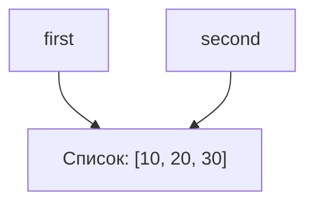
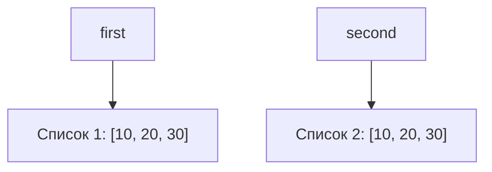

## Цель работы

Исследовать связь между именами и объектами, понять различия между присваиванием, поверхностным и глубоким копированием, а также познакомиться с механизмами управления памятью в CPython.

## Задание 1

### Эксперимент A

```Python
a = 10
b = a
  
print(a, b)
print(id(a), id(b))

a += 1
  
print(a, b)
print(id(a), id(b))
```

Ожидалось что `print(a, b)` в первом случае выведет `10 10`, а во втором `11 11`, а `print(id(a), id(b))` в обоих случаях выведет одинаковые значения как для `a`, так и для `b`. Но в результате работы программы `print(a, b)` в первом случае выведел `10 10`, а во втором `11 10`, а `print(id(a), id(b))` в первом случае выведел два одинаковых значения, а во втором два разных.
### Эксперимент B

Изначальная программа:

```Python
first = [10, 20]
second = first

print(first, second)
print(id(first), id(second))

second.append(30)

print(first, second)
print(id(first), id(second))
```

Дополненная программа:

```Python
first = [10, 20]
second = first

print(first, second)
print(id(first), id(second))

second.append(30)

print(first, second)
print(id(first), id(second))

# Переназначение second на новый список
second = first.copy()
  
# Сравнение списков
print(first == second)
print(first is second)
  
# Изменение нового списка
second.append(40)
  
# Проверка
print(first, second)
```

**Прогноз**
-  1-ый `print(first, second)` --> `[10, 20] [10, 20]`
- 1-ый `print(id(first), id(second))` --> два равных значения
-  2-ой `print(first, second)` --> `[10, 20, 30] [10, 20, 30]`
-  2-ой `print(id(first), id(second))` --> два равных значения
- `print(first == second)` --> `True`
- `print(first is second)` --> `False` 
-  3-ий `print(first, second)` --> `[10, 20, 30] [10, 20, 30, 40]`

**Фактический результат**

Фактический результат полностью соответствует прогнозу.

 **Схема связи имен и объектов до переназначения**



**Схема связи имен и объектов после переназначения**



### Практическая задача

В `task_1.py` был дописан следующий код:

```Python
import copy

first_config = [
	"name 1",
	[
		"member 1",
		"member 2",
		"member 3"
	],
	[
		"param1",
		"param2",
		"param3"
	]
]
  
second_config = first_config
second_config[0] = "name 2"
  
print(first_config[0], second_config[0])
  
third_config = copy.deepcopy(first_config)
  
assert third_config is not first_config
assert third_config[1] is not first_config[1]
assert third_config[2] is not first_config[2]
```

`print(first_config[0], second_config[0])` вывел в терминал `name 2 name 2`, что означает, что изменения сделанные для `second_config` применились и к `first_config`. 

При запуске программа выполнилась без ошибок, значит все 3 условия внутри `assert` оказались верны, а это значит что `first_config`
, `third_config` и все вложенные в них списки ссылаются на разные объекты, а значит `first_config` и `third_config` независимы, и изменение одного не повлечет изменение другого.
### Ответы на контрольные вопросы

1. Присваивание `second = first` не меняет объект. После него имя `second` начинает ссылаться на тот же объект, что и `first`.
2. При операции над неизменяемым объектом происходит создание нового объекта. Поэтому имя, которое раньше ссылалось на старый объект, начинает ссылаться на новый.
3. Проверить обозначают ли два имени один объект можно с помощью оператора `is`, который возвращает `True` в случае, если имена ссылаюся на один объект, и `False`, если на разные.

## Задание 2

Для выполнения задания был создан файл `task_2.py`:

```Python
import copy

original = [
    ["Python", 5],
    ["Algorithms", 4],
]

alias = original
shallow = original.copy()
deep = copy.deepcopy(original)

def log_lists_state() -> None:
    log_message = (
        f"original: {original}\n"
        f"    id(original):   {id(original)}\n"
        f"    id(original[0]):   {id(original[0])}\n"
        f"    id(original[0][1]):   {id(original[0][1])}\n\n"
        f"alias: {alias}\n"
        f"    id(alias):   {id(alias)}\n"
        f"    id(alias[0]):   {id(alias[0])}\n"
        f"    id(alias[0][1]):   {id(alias[0][1])}\n\n"
        f"shallow: {shallow}\n"
        f"    id(shallow):   {id(shallow)}\n"
        f"    id(shallow[0]):   {id(shallow[0])}\n"
        f"    id(shallow[0][1]):   {id(shallow[0][1])}\n\n"
        f"deep: {deep}\n"
        f"    id(deep):   {id(deep)}\n"
        f"    id(deep[0]):   {id(deep[0])}\n"
        f"    id(deep[0][1]):   {id(deep[0][1])}\n\n"
    )

    print(log_message)

# Изменение 1
original.append(["Databases", 5])
log_lists_state()

# Изменение 2
original[0][1] = 3
log_lists_state()
```

Переменная `alias` получает ссылку на тот же объект, что и `original`. Поверхностная копия `shallow` создаёт новый внешний список, но сохраняет ссылки на исходные вложенные списки. Глубокая копия `deep` создаёт отдельную структуру с собственными вложенными списками.

Для наблюдения за состоянием объектов была реализована функция `log_lists_state()`. Она выводит содержимое всех четырёх структур и значения `id()` для внешнего списка, первого вложенного списка и элемента, содержащего первую оценку.

После запуска программы был получен следующий результат:

```
original: [['Python', 5], ['Algorithms', 4], ['Databases', 5]]
    id(original):   140148833225152
    id(original[0]):   140148834389440
    id(original[0][1]):   10758992

alias: [['Python', 5], ['Algorithms', 4], ['Databases', 5]]
    id(alias):   140148833225152
    id(alias[0]):   140148834389440
    id(alias[0][1]):   10758992

shallow: [['Python', 5], ['Algorithms', 4]]
    id(shallow):   140148833122688
    id(shallow[0]):   140148834389440
    id(shallow[0][1]):   10758992

deep: [['Python', 5], ['Algorithms', 4]]
    id(deep):   140148833122560
    id(deep[0]):   140148833122624
    id(deep[0][1]):   10758992
    

original: [['Python', 3], ['Algorithms', 4], ['Databases', 5]]
    id(original):   140148833225152
    id(original[0]):   140148834389440
    id(original[0][1]):   10758928

alias: [['Python', 3], ['Algorithms', 4], ['Databases', 5]]
    id(alias):   140148833225152
    id(alias[0]):   140148834389440
    id(alias[0][1]):   10758928

shallow: [['Python', 3], ['Algorithms', 4]]
    id(shallow):   140148833122688
    id(shallow[0]):   140148834389440
    id(shallow[0][1]):   10758928

deep: [['Python', 5], ['Algorithms', 4]]
    id(deep):   140148833122560
    id(deep[0]):   140148833122624
    id(deep[0][1]):   10758992
```

В результате первого изменения новый элемент добавляется в `original`. Поскольку `alias` ссылается на тот же объект, изменение также отражается в `alias`.
Список `shallow` не содержит нового элемента, поскольку его внешний список является отдельным объектом. Список `deep` также не изменяется, так как он был создан до добавления нового элемента и ссылается на другие объекты. Таким образом, операция добавления элемента демонстрирует, что присваивание не создаёт новый объект, тогда как поверхностное и глубокое копирование создают независимые внешние списки.

В результате второго изменения первая оценка изменяется с `5` на `3`.
Данное изменение наблюдается в `original`, `alias` и `shallow`, поскольку первые два имени ссылаются на один внешний список, а `shallow` содержит ссылку на тот же первый вложенный список.
В `deep` оценка остаётся равной `5`, поскольку первый вложенный список глубокой копии является отдельным объектом.

Результаты наблюдений оформлены в виде следующей таблицы:

| Операция            | Новый внешний объект | Новые вложенные объекты | Изменения независимы                            |
| ------------------- | -------------------- | ----------------------- | ----------------------------------------------- |
| Присваивание        | Не создается         | Не создаются            | Нет                                             |
| Поверхностная копия | Создается            | Не создаются            | Только для операций над неизменяемыми объектами |
| Глубокая копия      | Создается            | Создаются               | Все изменения независимы                        |

Далее для иследования создания матриц был добавлен следующий код:

```Python
wrong_matrix = [[0] * 3] * 3
wrong_matrix[0][0] = 1

correct_matrix = [[0] * 3 for _ in range(3)]
correct_matrix[0][0] = 1

print(wrong_matrix)
print(correct_matrix)
```

Результат выполнения программы:

```
[[1, 0, 0], [1, 0, 0], [1, 0, 0]]
[[1, 0, 0], [0, 0, 0], [0, 0, 0]]
```

Можно заметить, что операция `wrong_matrix[0][0] = 1` поменяла не только первый вложенный список, но и все остальные. Так произошло, потому что операция умножения внешнего списка не создаёт три независимых вложенных списка. Вместо этого формируются три ссылки на один и тот же список.

Для создания независимых вложенных списков был использован генератор списка:

```Python
correct_matrix = [[0] * 3 for _ in range(3)]
correct_matrix[0][0] = 1
```

При таком способе на каждой итерации создаётся новый вложенный список. Поэтому изменение одного элемента затрагивает только соответствующую строку.

Различие между матрицами определяется идентичностью вложенных объектов. В ошибочном варианте все строки являются одним объектом, а в правильном - каждая строка представляет собой отдельный список.

### Ответы на вопросы для анализа

1. Поверхностная копия создаёт новый внешний объект, но сохраняет ссылки на вложенные объекты исходной структуры. Глубокая копия рекурсивно копирует вложенные объекты. Благодаря этому изменяемые вложенные структуры становятся независимыми от исходных.
2. Глубокое копирование может требовать дополнительных вычислительных ресурсов и памяти. Кроме того, неизменяемые объекты, такие как строки и целые числа, обычно не требуют отдельного экземпляра для обеспечения независимости данных. Следовательно, глубокое копирование следует применять тогда, когда действительно необходима независимость вложенных объектов.
3. Поверхностная копия подходит, когда список состоит из данных неизменяемых типов. Также оно применимо, когда вложенные объекты намеренно должны оставаться общими для нескольких частей программы.

## Задание 3

Код в файле `task_3.py`:

```Python
import sys

data = [1, 2, 3]
print("После создания:", sys.getrefcount(data))

alias = data
print("После создания alias:", sys.getrefcount(data))

container = [data]
print("После помещения в контейнер:", sys.getrefcount(data))

del alias
print("После del alias:", sys.getrefcount(data))

container.clear()
print("После очистки контейнера:", sys.getrefcount(data))
```

Представим прогноз истории изменения счетчика ссылок в виде таблицы:

|                                   | Значение `sys.getrefcount(data)` |
| --------------------------------- | -------------------------------- |
| После создания списка             | 1                                |
| После присваивания                | 2                                |
| После помещения в `container`<br> | 3                                |
| После удаления`alias`             | 2                                |
| После очистки `container`         | 1                                |

Аналогично представим фактический результат:

|                                   | Значение `sys.getrefcount(data)` |
| --------------------------------- | -------------------------------- |
| После создания списка             | 2                                |
| После присваивания                | 3                                |
| После помещения в `container`<br> | 4                                |
| После удаления`alias`             | 3                                |
| После очистки `container`         | 2                                |

Можно заметить, что `sys.getrefcount()` всегда возвращает на одну ссылку больше ожидаемого. Так происходит, потому что при вызове `sys.getrefcount()` объект `data` временно передается в функцию как аргумент. В CPython это создает дополнительную ссылку на время вызова, поэтому значение счетчика на единицу больше ожидаемого.

Инструкции, увеличивающие счетчик ссылок:

- `data = [1, 2, 3]` - создание списка и связывание его с именем `data`.
- `alias = data` - имя `alias` начинает ссылаться на тот же список, что и `data`, поэтому счетчик увеличивается на 1.
- `container = [data]` - список `container` начинает хранить ссылку на объект `data`, поэтому счетчик увеличивается еще на 1.

Инструкции, уменьшающие счетчик ссылок:

- `del alias` - удаляет имя `alias` и освобождает связанную с ним ссылку. Сам список продолжает существовать.
- `container.clear()` - удаляет все элементы списка `container`. Поскольку элементом была ссылка на `data`, эта ссылка освобождается.

Инструкция `del alias` удаляет привязку имени `alias` к объекту. Она не является прямой командой уничтожения объекта. Это сделано, потому что на данный объект может существовать несколько ссылок, и если `del` будет удалять сам объект, то оставшиеся ссылки будут вести на несуществующий объект.

Далее в `task_3.py` был добавлен следующий код:

```Python
import weakref


class Record:
    pass


record = Record()
weak_record = weakref.ref(record)

print(weak_record())
del record
print(weak_record())
```

Ожидалось, что после запуска `print(weak_record())` до удаления `record` выведет объект класса `Record`, а после - ничего. Ниже представлен фактический результат, соответствующий прогнозу.

```
<__main__.Record object at 0x7fc1d2df2e40>
None
```

Так произошло, потому что слабая ссылка не увеличивает счетчик ссылок объекта и, как следствие, не удерживает объект от удаления. Таким образом, после удаления единственной сильной ссылки на объект инструкцией `del record` счетчик ссылок объекта, на которыйй ссылался `record` стал равен нулю и объект был освобожден. Поэтому `print(weak_record())` во второй раз выводит `None`. 

Слабые ссылки могут быть полезны в ситуациях, когда необходимо чтобы 2 оъекта ссылались друг на друга. Использование слабых ссылок в таком случае ускорит освобождение объекта, поскольку не возникнет циклических ссылок.

### Практическая задача

Код программы для демонстрации работы слабого словаря:

```Python
first = Record()
second = Record()
third = Record()

weak_dict = weakref.WeakValueDictionary()

weak_dict["first"] = first
weak_dict["second"] = second
weak_dict["third"] = third

del third

print(*weak_dict.keys())

del second

print(*weak_dict.keys())
```

После создания трех объектов класса `Record` и добавления их в слабый словарь `weak_dict` реестр содержит три записи: `first`, `second` и `third`. После выполнения команды `del third` удаляется сильная ссылка на третий объект, поэтому он уничтожается, а соответствующая запись автоматически исчезает из слабого словаря. Ожидалось, что при первом выводе на экран должны отобразиться ключи `first` и `second`.
Затем выполняется команда `del second`, которая удаляет сильную ссылку на второй объект. Объект уничтожается, а его запись удаляется из слабого словаря. При втором выводе на экран должен отобразиться только ключ `first`, поскольку сильная ссылка на первый объект продолжает существовать.

Полученный результат соответствует ожидаемому. Подтвердилось, что слабый словарь не поддерживает время жизни объектов: когда удаляется последняя сильная ссылка на объект, он уничтожается, а его запись автоматически удаляется из слабого словаря.

### Ответы на вопросы для анализа

1. В CPython подсчет ссылок позволяет освободить объект, когда количество сильных ссылок на него достигает нуля. При этом необходимо учитывать циклические ссылки и другие механизмы управления памятью.
2. Освобождение объекта означает, что память, которую он занимал, может быть повторно использована Python или его аллокатором. При этом память не обязательно немедленно возвращается операционной системе. Например, Cpython может оставить освобожденную память для создания новых объектов, чтобы избежать дополнительных операций с ОС.
3. Сильная ссылка удерживает объект в памяти и увеличивает счетчик ссылок. Пока существует хотя бы одна сильная ссылка, объект остается доступным. Слабая ссылка, в отличие от сильной, не удерживает объект в памяти и не увеличивает счетчик ссылок. Она позволяет получить доступ к объекту, пока он существует. Если все сильные ссылки на объект удалены и объект освобожден, слабая ссылка больше не позволяет получить его и возвращает `None`.

## Задание 4

Код программы `task_4.py`:

```Python
import gc

first = []
second = []

first.append(second)
second.append(first)

print("first ссылается на second:", first[0] is second)
print("second ссылается на first:", second[0] is first)

# вывод текущего состояния автоматического сборщика мусора
print(gc.isenabled())
# вывод порогов поколений
print(gc.get_threshold())
# вывод статистики поколений
print(gc.get_stats())

first_id, second_id = id(first), id(second)

del first, second

collected = gc.collect()
print(collected)


# дополнительный эксперимент
gc.disable()

class Note:
    pass

a, b = Note(), Note()
a.other, b.other = b, a

list_1, list_2 = [], []
list_1.append(list_2)
list_2.append(list_1)

del a, b, list_1, list_2

print(gc.collect())

gc.enable()
```

Ожидалось, что при запуске программы первые две проверки должны вывести `True`, поскольку первый список содержит ссылку на второй, а второй - на первый, а также, что после удаления имён `first` и `second` и вызова `gc.collect()` , сборщик обнаружит и удалит два списка, образующих цикл. В дополнительном эксперименте создаются две циклических структур. После удаления внешних ссылок ручной вызов сборщика должен был обнаружить 4 циклически связанных объекта.

Фактический результат соответствует ожиданиям. 

**Недостаточность подсчета ссылок**

Главная проблема алгоритма подсчета ссылок заключается в том, что он не способен распознавать циклические зависимости между объектами. Если два или более объекта ссылаются друг на друга, их счетчики ссылок никогда не опустятся до нуля, даже если вся эта группа объектов стала полностью недоступна из основной программы.

**Назначение поколений**

Сборщик мусора использует поколения, чтобы эффективнее искать циклический мусор. Новые объекты проверяются чаще, поскольку многие из них имеют короткий срок жизни. Объекты, пережившие несколько сборок, проверяются реже, что позволяет уменьшить накладные расходы на сборку мусора. Таким образом, поколения помогают распределять работу сборщика, не требуя каждый раз одинаково тщательно проверять все объекты программы.

### Практическая задача

Код практического задания:

```Python
before = gc.collect()
print(before)

a = {"name": "A", "links": []}
b = {"name": "B", "links": []}
c = {"name": "C", "links": []}
d = {"name": "D", "links": []}

a["links"].append(b)
b["links"].append(c)
c["links"].append(a)

print("A ->", a["links"][0]["name"])
print("B ->", b["links"][0]["name"])
print("C ->", c["links"][0]["name"])
print("D не имеет связей: ", d["links"] == [])

del a
del b
del c

after = gc.collect()
print(after)
```

Ожидалось, что при запуске программы сначала будет выведено количество объектов, собранных до создания графа, которое обычно равно 0. Затем программа покажет связи между узлами, подтверждая, что три узла образуют замкнутый цикл. Для независимого узла `D` будет выведено `True`, что означает отсутствие связей с другими узлами. После удаления внешних ссылок на узлы `A`, `B` и `C` и вызова `gc.collect()` ожидается сборка трёх словарей и трёх списков, содержащих связи между ними, или всего 6 объектов. Фактическое количество собранных объектов может отличаться в зависимости от состояния сборщика мусора перед запуском эксперимента. 

Фактический результат соответствует ожидаемому.

### Ответы на вопросы для анализа

1. Циклическая ссылка возникает, когда объект прямо или косвенно ссылается сам на себя.
2. Счётчик ссылок учитывает ссылки на объект, в том числе ссылки со стороны других объектов. Поэтому объекты могут продолжать ссылаться друг на друга даже после удаления всех внешних ссылок.
3. Поколения позволяют оптимизировать поиск циклического мусора. Многие объекты существуют недолго и могут быть удалены быстро, тогда как другие продолжают использоваться длительное время. Поэтому сборщик чаще проверяет новые объекты, а пережившие несколько сборок проверяет реже.

## Задание 5

### Часть 1

В файл `task_5.py` был добавлен следующий код:

```Python
import sys

empty_list = []
list_10 = [390, 391, 392, 393, 394, 395, 396, 397, 398, 399]
tuple_10 = (390, 391, 392, 393, 394, 395, 396, 397, 398, 399)
string = 'abcdefghij'
integer = 333

print("пустой список:", sys.getsizeof(empty_list), "байт")
print("список из десяти целых чисел:", sys.getsizeof(list_10), "байт")
print("кортеж:", sys.getsizeof(tuple_10), "байт")
print("строка из десяти символов:", sys.getsizeof(string), "байт")
print("целое число:", sys.getsizeof(integer), "байт")
print("объект None:", sys.getsizeof(None), "байт")
```

После запуска был получен следующий результат:

```
пустой список: 56 байт
список из десяти целых чисел: 136 байт
кортеж: 120 байт
строка из десяти символов: 51 байт
целое число: 28 байт
объект None: 16 байт
```

Видно, что размер списка и кортежа из 10 элементов значительно меньше размера 10 объектов чисел. Так происходит, потому что `sys.getsizeof()` возвращает размер, который учитывается непосредственно для этого объекта. А поскольку непосредственно в кортеже и в списке хранятся только ссылки на объекты, то размер коллекции не обязательно включает полный размер всех объектов, на которые он ссылается.

### Часть 2

В `task_5.py` был добавлен следующий код:

```Python
arr = []
prev_size = sys.getsizeof(arr)

for i in range(100):
    arr.append(i)

    if sys.getsizeof(arr) != prev_size:
        print(f"Размер: {sys.getsizeof(arr)} байт")
        prev_size = sys.getsizeof(arr)
```

После запуска был получен следующий результат:

```
Размер: 88 байт
Размер: 120 байт
Размер: 184 байт
Размер: 248 байт
Размер: 312 байт
Размер: 376 байт
Размер: 472 байт
Размер: 568 байт
Размер: 664 байт
Размер: 792 байт
Размер: 920 байт
```

Размер списка не увеличивается после каждого вызова `append()`. Cpython выделяет дополнительную память порциями, поэтому размер меняется только тогда, когда заканчивается зарезервированное место. Запас памяти нужен для того, чтобы добавление новых элементов происходило быстрее и не требовало перераспределения памяти после каждого добавления. Длина списка показывает количество элементов в нём, а размер - объём памяти, занимаемый самим списком. 

### Часть 3

В `task_5.py` был добавлен следующий код:

```Python
import tracemalloc

tracemalloc.start()

numbers = list(range(100_000))

current, peak = tracemalloc.get_traced_memory()
print(f"текущее использование памяти: {(current / 1000):.2f} Кбайт")
print(f"пиковое использование памяти: {(peak / 1000):.2f} Кбайт")

tracemalloc.stop()
tracemalloc.start()

numbers = range(100_000)

current, peak = tracemalloc.get_traced_memory()
print(f"текущее использование памяти: {(current / 1000):.2f} Кбайт")
print(f"пиковое использование памяти: {(peak / 1000):.2f} Кбайт")

tracemalloc.stop()
```

Ожидалось что объем используемой памяти в первом случае будет значительно больше, чем во втором.
После запуска результат соответствовал ожиданиям:

```
текущее использование памяти: 3991.83 Кбайт
пиковое использование памяти: 3991.95 Кбайт
текущее использование памяти: 0.08 Кбайт
пиковое использование памяти: 0.08 Кбайт
```

Так произошло, потому что материализованный список требует значительно больше памяти, поскольку хранит ссылки на все элементы. Объект `range` не создаёт заранее все числа, а позволяет получать их по мере необходимости.

### Итоговый анализ

1. Использование кортежей вместо списков, если изменение данных не требуется: первый эксперимент показал, что кортеж занимает меньше памяти, чем список, при том, что они содержат одинаковые элементы.
2. Использование `range` вместо списка, если не требуется хранить все элементы. Третий эксперимент показал, что `range(100_000)` занимает значительно меньше памяти, чем `list(range(100_000))`.
3. Избегать ненужного дублирования данных. Первый эксперимент показал, что контейнер хранит ссылки на объекты. Повторное создание одинаковых больших структур может увеличивать расход памяти. По возможности следует повторно использовать существующие данные.

### Практическая задача

Код файла `memory_report.py`:

```Python
import sys
import tracemalloc
from collections.abc import Callable


class FirstExperimentResult:
    def __init__(
        self,
        name: str,
        count: int,
        object_size: int, 
        current_memory: int,
        peak_memory: int
    ):
        self.name = name
        self.count = count
        self.object_size = object_size
        self.current_memory = current_memory
        self.peak_memory = peak_memory

class SecondExperimentResult:
    def __init__(
        self,
        count: int,
        list_size: int,
    ):
        self.count = count
        self.list_size = list_size

class ThirdExperimentResult:
    def __init__(
        self,
        name: str,
        current_memory: int,
        peak_memory: int
    ):
        self.current_memory = current_memory
        self.peak_memory = peak_memory
        self.name = name


def get_first_experiment_result(
        name: str,
        count: int,
        factory: Callable
    ) -> FirstExperimentResult:
    tracemalloc.start()

    obj = factory()
    current, peak = tracemalloc.get_traced_memory()
    object_size = sys.getsizeof(obj)

    tracemalloc.stop()

    result = FirstExperimentResult(
        name=name,
        count=count,
        object_size=object_size,
        current_memory=current,
        peak_memory=peak
    )

    del obj
    return result

def get_growing_list_history() -> dict:
    result = {
        "history": [],
        "peak_memory": None,
        "current_memory": None
    }

    tracemalloc.start()

    arr = []
    prev_size = sys.getsizeof(arr)

    for i in range(100):
        arr.append(i)
        current_size = sys.getsizeof(arr)

        if current_size != prev_size:
            result["history"].append(
                SecondExperimentResult(
                    count=i,
                    list_size=current_size
                )
            )
            prev_size = current_size

    current, peak = tracemalloc.get_traced_memory()
    result["current_memory"] = current
    result["peak_memory"] = peak

    tracemalloc.stop()

    return result

def get_third_experiment_result() -> dict:
    result = {
        "list": None,
        "range": None
    }
    tracemalloc.start()

    numbers = list(range(100_000))

    current, peak = tracemalloc.get_traced_memory()
    result["list"] = ThirdExperimentResult(
        name="список из 100000 элементов",
        current_memory=current,
        peak_memory=peak
    )

    tracemalloc.stop()
    tracemalloc.start()

    numbers = range(100_000)

    current, peak = tracemalloc.get_traced_memory()
    result["range"] = ThirdExperimentResult(
        name="объект range(100_000)",
        current_memory=current,
        peak_memory=peak
    )

    tracemalloc.stop()

    return result

def print_report(result: dict) -> None:
    print("================= Размер отдельных объектов =================\n")

    for obj_data in result["experiment_1"]:
        print(
            f"{obj_data.name}:\n\n"
            f"  - кол-во элементов:  {obj_data.count}\n"
            f"  - размер внешнего объекта:  {obj_data.object_size}\n"
            f"  - текущее использование памяти: {obj_data.current_memory} байт\n"
            f"  - максимальное использование памяти: {obj_data.peak_memory} байт\n"            
        )


    print("======================= Рост списка ========================\n")
    print(
        f"максимальное использование памяти: {result['experiment_2']["peak_memory"]} байт\n\n"
        f"текущее использование памяти: {result['experiment_2']["current_memory"]} байт\n\n"
        f"история изменения размера списка:\n",
        f"____________________________________________________\n"
        f"| кол-во элементов в списке | размер списка (в байт) |\n"
        f"|___________________________|________________________|"
    )

    for obj_data in result["experiment_2"]["history"]:
        print(
            f"|{obj_data.count:^27}|{obj_data.list_size:^24}|\n"
            f"|___________________________|________________________|"
        )


    print("\n=============== Измерение через tracemalloc ================\n")

    list_obj_data: ThirdExperimentResult = result['experiment_3']["list"]
    range_obf_data: ThirdExperimentResult = result['experiment_3']["range"]
    print(
        f"{list_obj_data.name}:\n\n"
        f"  - текущее использование памяти: {(list_obj_data.current_memory / 1000):.2f} Кбайт\n"
        f"  - максимальное использование памяти: {(list_obj_data.peak_memory / 1000):.2f} Кбайт\n\n"
        f"{range_obf_data.name}:\n\n"
        f"  - текущее использование памяти: {(range_obf_data.current_memory / 1000):.2f} Кбайт\n"
        f"  - максимальное использование памяти: {(range_obf_data.peak_memory / 1000):.2f} Кбайт\n\n"
        f"отношение пиковых объемов двух сравниваемых сценариев: {(list_obj_data.peak_memory / range_obf_data.peak_memory):.2f}"
    )
    

result = {
    "experiment_1": [],
    "experiment_2": None,
    "experiment_3": None
}


# Часть 1
result_first_experiment: list[FirstExperimentResult] = []

scenarios_first_experiment = [
    dict(
        name="пустой список",
        count=0,
        factory=lambda: []
    ),
    dict(
        name="список из десяти целых чисел",
        count=10,
        factory=lambda: list(range(390, 400))        
    ),
    dict(
        name="кортеж из десяти целых чисел",
        count=10,
        factory=lambda: tuple(list(range(390, 400)))       
    ),
    dict(
        name="строка из десяти символов",
        count=10,
        factory=lambda: "abcdefghij"      
    ),
    dict(
        name="целое число",
        count=1,
        factory=lambda: 333      
    ),
    dict(
        name="объект None",
        count=0,
        factory=lambda: None     
    ),
]

for scenario in scenarios_first_experiment:
    result["experiment_1"].append(
        get_first_experiment_result(**scenario)
    )

# Часть 2
result["experiment_2"] = get_growing_list_history()

# Часть 3
result["experiment_3"] = get_third_experiment_result()

# Печать отчета
print_report(result)
```

Для структурирования результатов в начале скрипта объявляются три класса данных: `FirstExperimentResult`, `SecondExperimentResult`, `ThirdExperimentResult`. Сами замеры реализованы следующим образом:

- Первый эксперимент : `get_first_experiment_result` принимает функцию `factory`, которая создает объект внутри контекста `tracemalloc.start()` и `tracemalloc.stop()`. Функция считывает размер внешнего объекта через `sys.getsizeof(obj)` и фактический вес в памяти через `tracemalloc.get_traced_memory()`.
- Второй эксперимент: В `get_growing_list_history` в цикле  добавляются элементы от 0 до 99 в список `arr`. На каждой итерации проверяется `sys.getsizeof(arr)`. Если размер изменился, в историю записывается количество элементов и новый размер списка.
- Третий эксперимент: `get_third_experiment_result` поочередно запускает и останавливает `tracemalloc` для двух сценариев: создания списка `list(range(100_000))` и создания объекта `range(100_000)`.

В основной части скрипта инициализируется словарь `result`. Сценарии для первого теста описаны в виде списка словарей `scenarios_first_experiment`, которые распаковываются при вызове функции. После выполнения всех трех функций объект `result` передается в `print_report`, где данные форматируются в три наглядных блока: размеры одиночных объектов, шаги роста списка и сравнение размера списка и `range`.

После запуска утилиты был получен следующий отчет:

```
================= Размер отдельных объектов =================

пустой список:

    кол-во элементов:  0
    размер внешнего объекта:  56
    текущее использование памяти: 0 байт
    максимальное использование памяти: 0 байт 

список из десяти целых чисел:

    кол-во элементов:  10
    размер внешнего объекта:  136
    текущее использование памяти: 456 байт
    максимальное использование памяти: 544 байт 

кортеж из десяти целых чисел:

    кол-во элементов:  10
    размер внешнего объекта:  120
    текущее использование памяти: 376 байт
    максимальное использование памяти: 544 байт 

строка из десяти символов:

    кол-во элементов:  10
    размер внешнего объекта:  51
    текущее использование памяти: 0 байт
    максимальное использование памяти: 0 байт 

целое число:

    кол-во элементов:  1
    размер внешнего объекта:  28
    текущее использование памяти: 0 байт
    максимальное использование памяти: 0 байт 

объект None:

    кол-во элементов:  0
    размер внешнего объекта:  16
    текущее использование памяти: 0 байт
    максимальное использование памяти: 0 байт 

======================= Рост списка ========================

максимальное использование памяти: 4484 байт

текущее использование памяти: 4344 байт

история изменения размера списка:
 ____________________________________________________
| кол-во элементов в списке | размер списка (в байт) |
|___________________________|________________________|
|             0             |           88           |
|___________________________|________________________|
|             4             |          120           |
|___________________________|________________________|
|             8             |          184           |
|___________________________|________________________|
|            16             |          248           |
|___________________________|________________________|
|            24             |          312           |
|___________________________|________________________|
|            32             |          376           |
|___________________________|________________________|
|            40             |          472           |
|___________________________|________________________|
|            52             |          568           |
|___________________________|________________________|
|            64             |          664           |
|___________________________|________________________|
|            76             |          792           |
|___________________________|________________________|
|            92             |          920           |
|___________________________|________________________|

=============== Измерение через tracemalloc ================

список из 100000 элементов:

    текущее использование памяти: 3991.83 Кбайт
    максимальное использование памяти: 3991.95 Кбайт 

объект range(100_000):

    текущее использование памяти: 0.08 Кбайт
    максимальное использование памяти: 0.08 Кбайт 

отношение пиковых объемов двух сравниваемых сценариев: 49899.40
```

Разница в потреблении памяти между списком и кортежем из 10 элементов обусловлена различной архитектурой этих структур данных в Python.

В отчете `sys.getsizeof` показывает 136 байт для списка и 120 байт для кортежа. Кортеж является неизменяемым, поэтому Python выделяет под него ровно столько памяти, сколько необходимо для хранения ссылок на 10 элементов. Список - это динамический массив. Чтобы не перевыделять память при каждом добавлении элемента, Python создает его с запасом. Из-за этого избыточного резервирования элементов внешний объект списка весит больше.

Также можно заметить, что объем использованной памяти больше размера внешних объектов кортежа и списка. Это объясняется тем, что при измерении всей выделяемой памяти учитывается не только размер внешнего объекта кортежа или списка, но и элементы, на которые ссылаются внешние объекты этих коллекций.
## Вывод

В ходе выполнения лабораторной работы были подробно изучены особенности ссылочной модели Python и механизмы управления памятью в реализации CPython. Экспериментальным путем подтверждено различие между изменяемыми и неизменяемыми типами данных, а также критическая разница между операцией присваивания, поверхностным и глубоким копированием. Было установлено, что наиболее опасными ошибками при работе с изменяемыми объектами являются непреднамеренное совместное использование ссылок и некорректная инициализация вложенных структур, например, матриц через умножение списков.


