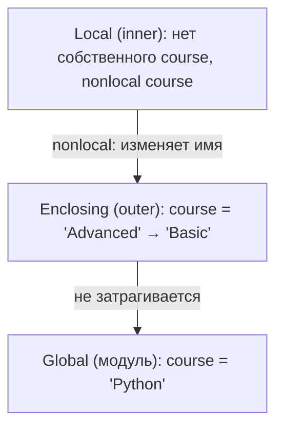

## Цель работы

Научиться переводить условие задачи в алгоритм, выбирать подходящую структуру данных и разделять программу на небольшие функции с понятными контрактами.

## Задание 1

Для выполнения задания был создан файл `task_1.py`. Функция `get_student_result(score, work_type, absences)` проверяет входные данные, определяет уровень результата и формирует пояснение к типу работы:

```Python
def get_student_result(score: int, work_type: str, absences: int) -> dict:
    # input validation
    if not(0 <= score <= 100):
        print("Invalid value of student's grade")
        raise ValueError("Invalid value of student's grade")

    if not(0 <= absences <= 5):
        print("Invalid value of absences")
        raise ValueError("Invalid value of absences")

    # defining student's level
    levels = [
        "недостаточный",
        "удовлетворительный",
        "хороший",
        "отличный"
    ]

    if 90 <= score <= 100:
        student_level_index = 3

    elif 75 <= score <= 89:
        student_level_index = 2

    elif 60 <= score <= 74:
        student_level_index = 1

    elif score <= 59:
        student_level_index = 0

    if absences > 3 and student_level_index != 0:
        student_level_index -= 1

    # matching work type
    match work_type:
        case "exam":
            work_type_annotation = "экзаменационная работа"

        case "project":
            work_type_annotation = "проектная работа"

        case "practice":
            work_type_annotation = "практическая работа"

        case _:
            work_type_annotation = None

    return {
        "score_level": levels[student_level_index],
        "work_type_annotation": work_type_annotation 
    }
```

Данные считываются через `input()`. Если значения выходят за допустимые диапазоны, функция выводит сообщение и выбрасывает `ValueError`, а основная часть программы завершается с кодом 1 и не выполняет классификацию.

Уровни хранятся в списке `levels` от худшего к лучшему, поэтому снижение уровня на одну ступень сводится к уменьшению индекса. Условие `student_level_index != 0` не позволяет опуститься ниже уровня «недостаточный».

Для набора `100`, `exam`, `4` программа вывела:

```
экзаменационная работа хороший
```

### Тестовые сценарии

Проверка выполнена с помощью `assert` на десяти наборах данных, включая все границы диапазонов (`0`, `59`, `60`, `74`, `75`, `89`, `90`, `100`). Все проверки прошли без ошибок, поэтому фактический результат совпал с ожидаемым.

| № | Результат | Тип работы | Пропуски | Ожидаемый результат | Фактический результат |
| - | --------- | ---------- | -------- | ------------------- | --------------------- |
| 1 | 100 | exam | 3 | экзаменационная работа, отличный | совпадает |
| 2 | 100 | exam | 4 | экзаменационная работа, хороший | совпадает |
| 3 | 90 | practice | 3 | практическая работа, отличный | совпадает |
| 4 | 89 | practice | 5 | практическая работа, удовлетворительный | совпадает |
| 5 | 75 | project | 0 | проектная работа, хороший | совпадает |
| 6 | 75 | project | 4 | проектная работа, удовлетворительный | совпадает |
| 7 | 74 | exam | 4 | экзаменационная работа, недостаточный | совпадает |
| 8 | 60 | exam | 2 | экзаменационная работа, удовлетворительный | совпадает |
| 9 | 59 | exam | 0 | экзаменационная работа, недостаточный | совпадает |
| 10 | 0 | exam | 5 | экзаменационная работа, недостаточный | совпадает |

### Порядок проверки условий

Сначала проверяются диапазоны входных данных: некорректные значения отсекаются до классификации. Затем уровень определяется цепочкой `if / elif` от высшего диапазона к низшему. Ветви взаимно исключают друг друга, поскольку диапазоны не пересекаются, и после проверки диапазона любое значение попадает ровно в одну из них. Ветвь `elif score <= 59` фактически выполняет роль `else`: отдельной ветви для случая, когда не подошло ни одно условие, не требуется, так как такой случай недостижим. Снижение уровня за пропуски выполняется после определения базового уровня, иначе не от чего было бы понижать. В `match / case` ветвь `case _` срабатывает только для неизвестного типа работы, при этом для корректных значений `exam`, `project`, `practice` она недостижима.

### Практическое расширение

Список из десяти записей `input_data` обрабатывается в цикле: для каждой записи вызывается `get_student_result`, формируется строка результата, а в словаре `levels_count` увеличивается счетчик соответствующего уровня. Исходный список не изменяется.

```Python
levels_count = {
    "недостаточный": 0,
    "удовлетворительный": 0,
    "хороший": 0,
    "отличный": 0
}

for student in input_data:
    student_result = get_student_result(*student)

    levels_count[student_result["score_level"]] += 1

    print(f"{student_result['work_type_annotation']}: {student_result['score_level']}")

for level, count in levels_count.items():
    print(f'Отметка "{level}": {count}')
```

Результат выполнения:

```
экзаменационная работа: отличный
экзаменационная работа: хороший
практическая работа: отличный
практическая работа: удовлетворительный
проектная работа: хороший
проектная работа: удовлетворительный
экзаменационная работа: недостаточный
экзаменационная работа: удовлетворительный
экзаменационная работа: недостаточный
экзаменационная работа: недостаточный
Отметка "недостаточный": 3
Отметка "удовлетворительный": 3
Отметка "хороший": 2
Отметка "отличный": 2
```

Сумма счетчиков равна 10, что совпадает с количеством записей.

## Задание 2

Для выполнения задания был создан файл `task_2.py`. Сначала за один проход по списку `measurements` вычисляются сумма, минимум, максимум, количество четных значений и длина списка:

```Python
measurements = [12, 15, 11, 18, 18, 9, 21, 15, 7, 18]

max_value = measurements[0]
min_value = measurements[0]
total = 0
length = 0
count_even = 0

for n in measurements:
    # sum of elements
    total += n

    # min value
    if n < min_value:
        min_value = n

    # max value
    if n < max_value:
        max_value = n

    # count even elements
    if n % 2 == 0:
        count_even += 1

    # length of array
    length += 1

average = total / length
count_gt_average = 0

for n in measurements:
    if n > average:
        count_gt_average += 1
```

Среднее арифметическое становится известно только после первого прохода, поэтому подсчет значений, превосходящих среднее, выполняется вторым проходом.

Затем реализован линейный поиск первого вхождения числа, введенного пользователем:

```Python
target = int(input("input number: "))

index = -1

for i in range(length):
    if measurements[i] == target:
        index = i
        break

print(f"index in measurements list: {index}")
```

Ожидалось, что программа выведет сумму `144`, минимум `7`, максимум `21`, `4` четных значения и `6` значений, превосходящих среднее `14.4`. Для введенного числа `7` ожидался индекс `8`. Фактический результат совпал с ожидаемым.

### Дополнительный алгоритмический эксперимент

В файле реализована функция `is_prime(n)`, перебирающая делители от `2` до `int(n**0.5)` включительно:

```Python
def is_prime(n: int):
    for divider in range(2, int(n**0.5) + 1):
        if n % divider == 0:
            return True

    return False
```

Оценки сложности:

| Алгоритм | Время | Дополнительная память | От чего зависит число операций |
| -------- | ----- | --------------------- | ------------------------------ |
| Один проход (сумма, min, max, четные) | O(n) | O(1) | от длины списка `n` |
| Второй проход | O(n) | O(1) | от длины списка `n` |
| Линейный поиск | O(n) | O(1) | от длины списка `n` и положения искомого числа |
| Проверка простоты | O(n^0.5) | O(1) | от значения числа `n`|

Ограничение делителей квадратным корнем корректно, потому что если `n = a * b` и `a <= b`, то `a^2 <= a * b = n`, то есть меньший из двух делителей не превосходит `n^0.5`. Следовательно, если у числа есть нетривиальный делитель, то среди делителей до `n^0.5` обязательно найдется хотя бы один. Делители, большие `n^0.5`, образуют пары с уже проверенными меньшими делителями.

### Практическое расширение

Для сравнения линейного и бинарного поиска были реализованы функции `binary_search` и `linery_search`. Обе функции поиска возвращают пару из индекса и числа выполненных сравнений:

```Python
def binary_search(arr: list, target: int) -> tuple[int, int]:
    left = 0
    right = len(arr) - 1
    comparisons = 0

    while left <= right:
        mid = (left + right) // 2
        comparisons += 1

        if arr[mid] > target:
            right = mid - 1
            comparisons += 1
        
        elif arr[mid] < target:
            left = mid + 1
            comparisons += 1

        else:
            return mid, comparisons

    return -1, comparisons

def linery_search(arr: list, target: int) -> tuple[int, int]:
    comparisons = 0

    for i in range(len(arr)):
        comparisons += 1

        if arr[i] == target:
            return i, comparisons

    return -1, comparisons
```

Алгоритмы запускались на отсортированных списках случайных чисел размером 10, 100 и 1000 элементов. Искомое число `10**6` заведомо отсутствует в списках, поэтому поиск выполняется в худшем случае. Фактический результат:

```
n = 10
 _____________________________________________
|             | binary search | linery search |
|-------------|---------------|---------------|
|    time     |   0.008 мс    |   0.003 мс    |
| comparisons |       8       |      10       |
|_____________|_______________|_______________|

n = 100
 _____________________________________________
|             | binary search | linery search |
|-------------|---------------|---------------|
|    time     |   0.004 мс    |   0.006 мс    |
| comparisons |      14       |      100      |
|_____________|_______________|_______________|

n = 1000
 _____________________________________________
|             | binary search | linery search |
|-------------|---------------|---------------|
|    time     |   0.005 мс    |   0.060 мс    |
| comparisons |      20       |     1000      |
|_____________|_______________|_______________|
```

 Рост числа сравнений при увеличении `n` в 10 раз показывает разницу асимптотик: у линейного поиска он десятикратный, у бинарного - примерно на 6 сравнений.

Время работы при `n = 10` у линейного поиска оказалось меньше, чем у бинарного, а при `n = 1000` - в 12 раз больше. На малых данных накладные расходы и погрешность измерения сопоставимы с самим временем поиска, поэтому основным результатом сравнения служит число сравнений, а не время.

**Псевдокод бинарного поиска:**

```
Binary_search(A, low, high, V):
1  if high < low:
2      return low - 1
3  mid = low + ⌊(high - low)/2⌋
4  if V = A[mid]:
5      return mid
6  else if V < A[mid]:
7      return Binary_search(A, low, mid - 1, V)
8  else:
9      return Binary_search(A, mid + 1, high, V)
```

Временная сложность - O(log n), дополнительная память - O(1).

**Псевдокод сортировки выбором:**

```
Selection-sort(A):
1  for i = 1 to A.length - 1
2      min_index = i
3      for j = i + 1 to A.length
4          if A[j] < A[min_index]
5              min_index = j
6      swap(A[i], A[min_index])
```

Временная сложность - O(n^2), дополнительная память - O(1).

## Задание 3

Для выполнения задания был создан файл `task_3.py`. Для построения структур данных реализованы пять функций, каждая из которых за один проход по списку `submissions` формирует свою структуру.

Функция `get_labs_set` аналогична `get_students_set` и собирает множество идентификаторов работ из второго элемента кортежа. Для вычисления лучшего результата использован метод `dict.get()` со значением по умолчанию `-1`, меньшим любого допустимого результата, а для подсчета попыток - со значением `0`.

Для вывода студентов, которые сдавали обе работы, для каждого студента строится множество его работ, которое сравнивается с множеством `labs`:

```Python
for student in students:
    attempts: list[tuple[str, int]] = attempts_by_students[student]
    completed_labs = set()

    for lab, _ in attempts:
        completed_labs.add(lab)

    if completed_labs.issubset(labs):
        print(student)
```

Ожидалось, что будут выведены `anna` и `boris`, поскольку только они сдавали и `lab_01`, и `lab_02`. Порядок вывода зависит от порядка элементов множества и может отличаться при разных запусках. Фактический результат:

```
anna
boris
```

### Добавление новой записи

Новая запись `("daria", "lab_01", 5)` добавляется в список, после чего структуры обновляются без повторного построения:

```Python
submissions.append(("daria", "lab_01", 5))

new_student = submissions[-1][0]
new_lab = submissions[-1][1]
new_score = submissions[-1][2]
key = (new_student, new_lab)

students.add(new_student)
labs.add(new_lab)

if student not in attempts_by_students:
    attempts_by_students[student] = []
    
attempts_by_students[new_student].append((new_lab, new_score))

attempts_by_pairs[key] = attempts_by_pairs.get(key, 0) + 1
best[key] = max(best.get(key, -1), new_score)
```

Каждое обновление выполняется за O(1) в среднем.

### Обоснование выбора коллекций

Множество подходит для хранения уникальных значений**, потому что при добавлении элемента, который уже есть в множестве, ничего не меняется. Благодаря этому повторяющиеся имена и идентификаторы работ в `submissions` не нужно отфильтровывать вручную. Кроме того, проверка принадлежности и сравнение множеств выполняются эффективно.

Кортеж можно использовать как ключ словаря, потому что он неизменяем и его хеш не изменится за время жизни объекта (при условии, что все его элементы также хешируемы). Поэтому пара `(student, lab)` подходит в качестве составного ключа.

Список нельзя использовать как ключ словаря, потому что он изменяем и, следовательно, не хешируем. Если бы содержимое списка менялось, то менялся бы и его хеш, и запись в словаре стала бы недоступной.

Словарь предпочтительнее списка для частого поиска по составному ключу, потому что поиск по ключу в словаре в среднем выполняется за O(1), тогда как в списке кортежей потребовался бы перебор за O(n).

| Коллекция | Добавление | Поиск |
| --------- | ---------------------- | ----------------- |
| `set` | O(1) | O(1) |
| `dict` | O(1) | O(1) по ключу |
| `list` | O(1) в конец O(n) в середину | O(n) по значению |

### Практическое расширение

Реализованы функции `parse_request` и `process_request`. Первая разбивает строку запроса на команду и кортеж аргументов, вторая с помощью `match / case` выбирает операцию:.

В `process_request` поддержаны четыре команды: `student`, `best`, `attempts` и `completed`. В каждой ветви проверяется число аргументов, а для неизвестной команды предусмотрена ветвь `case _`. Результат выполнения запросов:

```
[('lab_01', 5), ('lab_02', 5), ('lab_01', 4)]
5
1
daria anna boris 
```

Команда `completed lab_01` вывела `daria`, поскольку к этому моменту в данные уже была добавлена запись студента `daria`.

Неизвестная команда и неверное число аргументов обрабатываются без аварийного завершения.

## Задание 4

Для выполнения задания был создан файл `task_4.py`, реализующий четыре функции: `arithmetic_mean`, `normalize_name`, `build_report`, `collect_tags`.

Параметры `precision` и `prefix` функции `build_report` стоят после `*` и поэтому могут передаваться только по имени. Входные коллекции функции не изменяют: `normalize_name` работает с новым списком, полученным из `split()`, `build_report` создает новый список вещественных чисел, а `collect_tags` накапливает результат в новом списке. Каждая функция начинает работу с проверки входных данных через `assert`.

Тестовые данные собраны в словаре `testing_data`. Вызовы функций демонстрируют позиционные и именованные аргументы, а также распаковку списка через `*` и словаря через `**`:

```Python
build_report_output = build_report(
    *testing_data["build_report"][0]["input"]["positional"],
    **testing_data["build_report"][0]["input"]["keyword"]
)

collect_tags_output = collect_tags(
    *testing_data["collect_tags"][0]["input"]["positional"][0],
    **testing_data["collect_tags"][0]["input"]["keyword"]
)
```

Результат выполнения:

```
2.0
Антон Иванович Чигур
Студент: Антон Иванович Чигур
Балл: 4.2
('tag1', 'tag2', 'tAG3')
```

Результаты соответствуют ожиданиям: лишние пробелы удалены, имя приведено к нужному регистру, при `lowercase=False` теги сохранили исходный регистр.

### Исследование LEGB

Для исследования правила LEGB был добавлен следующий код:

```Python
course = "Python"

def outer():
    course = "Advanced"

    def inner():
        nonlocal course
        course = "Basic"

    print(course)

    inner()

    print(course)

outer()

print(course)
```

Ожидалось, что программа выведет `Advanced`, `Basic`, `Python`. Фактический результат:

```
Advanced
Basic
Python
```

**Схема областей видимости**



Порядок поиска имени: Local -> Enclosing -> Global -> Built-in.

- Первый `print(course)` выполняется в `outer`. В локальной области `outer` имя `course` найдено сразу, поэтому выводится `Advanced`.
- В функции `inner` объявлено `nonlocal course`, поэтому при присваивании `course = "Basic"` интерпретатор не создает новое локальное имя, а ищет `course` в объемлющих областях (но не в глобальной). Найдя его в `outer`, он изменяет именно это имя.
- Второй `print(course)` в `outer` находит имя в той же области и выводит измененное значение `Basic`.
- Последний `print(course)` выполняется на уровне модуля, где найдено глобальное имя `course`, которое ни одна из функций не изменяла, поэтому выводится `Python`.

### Ошибка изменяемого значения по умолчанию

Исследуемая функция:

```Python
def add_result(value, results=[]):
    results.append(value)
    return results

print(add_result(3))
print(add_result(4))
```

Ожидалось, что каждый вызов вернет список только с переданным значением: `[3]` и `[4]`. Фактический результат:

```
[3]
[3, 4]
```

Значение по умолчанию вычисляется один раз, в момент выполнения инструкции `def`, а не при каждом вызове. Созданный список хранится как атрибут функции и живет столько же, сколько сама функция. Поскольку список изменяем, каждый вызов без второго аргумента получает ссылку на один и тот же объект и дополняет его, поэтому результаты предыдущих вызовов накапливаются.

### Практическое расширение

Реализована функция `apply_to_results`, принимающая другую функцию и последовательность значений, а также фабрика `make_threshold_checker`:

```Python
def apply_to_results(operation, values):
    result = []

    for value in values:
        result.append(operation(value))

    return result

def double(x: int | float) -> int | float:
    return 2 * x

data = [4, 6, 2, 7.0, 10]

print(f"Named function: {apply_to_results(double, data)}")
print(f"Lambda function: {apply_to_results(lambda x: x * 2, data)}")

def make_threshold_checker(threshold):
    def inner(value):
        return value >= threshold

    return inner

is_gt_10 = make_threshold_checker(10)
is_gt_100 = make_threshold_checker(100)

print(f"Checker 10: {is_gt_10(30)}")
print(f"Checker 100: {is_gt_100(30)}")
```

Результат выполнения:

```
Named function: [8, 12, 4, 14.0, 20]
Lambda function: [8, 12, 4, 14.0, 20]
Checker 10: True
Checker 100: False
```

Именованная функция и `lambda` дали одинаковый результат.

Две проверки `is_gt_10` и `is_gt_100` независимы: при каждом вызове `make_threshold_checker` создается новая область видимости со своим значением `threshold`, и функция `inner` запоминает ее в замыкании. В первой функции хранится `10`, во второй - `100`, поэтому одно и то же значение `30` проходит первую проверку и не проходит вторую.

## Задание 5

Для выполнения задания был создан файл `task_5.py`. Программа разбита на небольшие функции, каждая из которых отвечает за одну операцию.

### Выбранное правило для студента без результатов

Если у студента пустой список баллов, то для него в поля `best score`, `worst score` и `score` записывается строка `"отсутствует"`, а категория определяется как «недостаточный». Такие студенты не учитываются при вычислении статистики группы и в рейтинге: они выводятся в конце рейтинга со строкой «баллы отсутствуют».

### Контракты функций

| Функция | Допустимые входные данные | Результат | Особые случаи |
| ------- | ------------------------- | --------- | ------------- |
| `mean(values)` | непустой список чисел | среднее арифметическое, `float` | пустой список приводит к `ZeroDivisionError` |
| `minimum(values)` | непустой список чисел | минимальный элемент | пустой список приводит к `IndexError` |
| `maximum(values)` | непустой список чисел | максимальный элемент | пустой список приводит к `IndexError` |
| `classify(score)` | число от 0 до 100 | строка с категорией | значения вне диапазона возвращают `None` |
| `student_summary(name, results)` | `name` - строка, `results` - список `int`, возможно пустой | словарь с ключами `name`, `best score`, `worst score`, `score`, `result`, `results` | для пустого списка вместо чисел записывается `"отсутствует"`; при неверных типах выбрасывается `ValueError` |
| `group_summary(student_data)` | список словарей, полученных из `student_summary` | словарь со статистикой группы | для пустой группы или группы без баллов вместо чисел `"отсутствует"`; при неверном типе - `ValueError` |
| `find_top_students(student_data)` | список словарей студентов | список имен студентов с максимальным средним | если ни у кого нет баллов, возвращается пустой список |
| `format_report(student_data, group_data)` | список словарей студентов и словарь группы | текст отчета | студенты без баллов выводятся без форматирования чисел |

Вспомогательные функции `get_mean_result`, `get_max_result`, `get_min_result` отбирают средние баллы студентов, у которых они есть, и вызывают `mean`, `maximum` и `minimum`. Функция `count_categories` подсчитывает количество студентов в каждой категории.

### Тестирование

Для проверки подготовлено шесть сценариев, перечисленных в словаре `scenarios`. Результаты их запуска приведены в таблице:

| Сценарий | Входные данные | Ожидаемый результат | Фактический результат |
| -------- | -------------- | ------------------- | --------------------- |
| Обычный набор | Анна, Борис, Дарья, Илья | лидер - Дарья (93.75), средний балл группы ≈ 75.92, по одному студенту в каждой категории | совпадает |
| Один студент | Илья: [55, 61] | лучший, худший и средний балл группы равны 58.0, категория «недостаточный» | совпадает |
| Несколько лидеров | Анна и Валерия с одинаковыми баллами | лидеры - Анна и Валерия, оба «хорошо» | совпадает |
| Пустая группа | `{}` | во всех полях «отсутствует», счетчики равны 0, рейтинг пуст | совпадает |
| Студент без результатов | Анна: [] | «отсутствует», категория «недостаточный» | совпадает |
| Граничные значения | Анна: [90, 90, 90, 90], Иван: [89, 89] | Анна - «отличный», Иван - «хороший» | совпадает |

Фрагмент отчета для обычного набора данных:

```
============== Группа  ===============
Лучший балл: 93.75
Худший балл: 58.0
Средний балл: 75.91666666666667
Лучшие студенты: Дарья
Кол-во 'отлично': 1
Кол-во 'хорошо': 1
Кол-во 'удовлетворительно': 1
Кол-во 'недостаточно': 1

============== Рейтинг ===============
Дарья: 93.75 баллов
Анна: 85.25 баллов
Борис: 66.67 баллов
Илья: 58.00 баллов
```

Поля «Лучший балл» и «Худший балл» в отчете группы содержат лучший и худший средний балл среди студентов, а не лучший и худший отдельный результат.

### Декомпозиция и сложность

Программа разделена на три уровня: примитивные алгоритмы (`mean`, `minimum`, `maximum`), функции анализа данных (`classify`, `student_summary`, `group_summary`, `find_top_students`) и функции представления (`format_report`, `main`). Благодаря этому изменение одной части не затрагивает остальные.

Сложность построения общей статистики для `n` студентов, у каждого из которых не более `k` результатов: `student_summary` для одного студента выполняет `mean`, `maximum` и `minimum`, то есть O(n), поэтому для всех студентов - O(n * k). Затем `group_summary` выполняет несколько линейных проходов по списку студентов за O(n), а сортировка рейтинга при формировании отчета - O(n log n). Итоговая сложность - O(n * k + n log n), дополнительная память - O(n * k) на копии списков результатов в словарях студентов.

## Вывод

В ходе выполнения лабораторной работы были реализованы базовые алгоритмы на условных операторах и циклах, а также алгоритмы поиска (линейный и бинарный) с подсчетом сравнений. Было проведено сопоставление структур данных: множества, словари и кортежи в роли составных ключей показали, что выбор коллекции определяет сложность типичных операций. На примере функций с позиционными, именованными и произвольным числом аргументов, правила LEGB, ошибки изменяемого значения по умолчанию и замыканий были изучены механизмы работы функций в Python. Декомпозиция интеграционной программы на небольшие функции с ясными контрактами упростила проверку отдельных частей и поиск ошибок.
